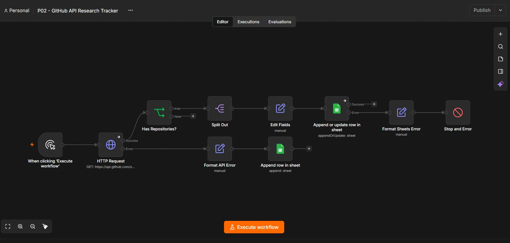

# P02 - GitHub API Research Tracker

**An n8n automation workflow that retrieves public GitHub repository data, processes JSON responses, synchronizes records with Google Sheets, prevents duplicate entries, and handles API and spreadsheet errors.**

## Project Overview

This is my second hands-on n8n automation portfolio project.

I built an automated research tracker that connects to the GitHub REST API, searches for repositories related to AI automation and n8n, extracts relevant information, and stores the results in Google Sheets.

The workflow also includes duplicate prevention, empty-response validation, API error logging, and Google Sheets failure handling.

The project demonstrates practical skills in API integration, data transformation, workflow automation, and troubleshooting.

## Tech Stack

- **n8n:** Workflow automation and conditional logic
- **GitHub REST API:** External API integration
- **Google Sheets:** Research database and API error logging
- **HTTP Request:** Fetching public repository data
- **JavaScript Expressions:** JSON processing, field mapping, and error handling
- **Docker Desktop:** Local n8n development environment

## Workflow Diagram



## How It Works

The workflow contains 10 nodes organized into success and error-handling branches.

1. **Manual Trigger:** Starts the workflow manually.
2. **HTTP Request:** Searches the GitHub API for repositories related to n8n automation.
3. **Has Repositories?:** Checks whether the API returned any repository records.
4. **Split Out:** Converts the repository array into individual records.
5. **Edit Fields:** Extracts and formats eight relevant repository fields.
6. **Append or Update Row:** Saves new repositories or updates existing records in Google Sheets.
7. **Format API Error:** Captures and formats GitHub API failures.
8. **Append Row in Sheet:** Logs API failures in the Error_Log worksheet.
9. **Format Sheets Error:** Processes errors returned by the repository Google Sheets operation.
10. **Stop and Error:** Marks the workflow execution as failed when a Google Sheets write error occurs.

### Processing Logic

**Successful API Request**

Manual Trigger → HTTP Request → Has Repositories? → Split Out → Edit Fields → Append or Update Row

**Empty API Response**

HTTP Request → Has Repositories? → No Records → End Workflow

**API Failure**

HTTP Request → Format API Error → Error_Log

**Google Sheets Failure**

Append or Update Row → Format Sheets Error → Stop and Error

## API Configuration

**Endpoint:**

`https://api.github.com/search/repositories`

**HTTP Method:** GET

**Query Parameters:**

| Parameter | Value |
|---|---|
| q | n8n automation |
| sort | updated |
| order | desc |
| per_page | 10 |

The workflow retrieves up to 10 matching repositories per execution.

## Google Sheets Structure

The spreadsheet contains two worksheets.

### Repositories

| Column | Description |
|---|---|
| repository_id | Unique GitHub repository ID |
| repository_name | Repository name |
| owner | GitHub account that owns the repository |
| description | Repository description |
| repository_url | Public GitHub repository URL |
| stars | Number of stars |
| last_updated | Repository's last updated timestamp |
| date_collected | Timestamp when the workflow processed the record |

**Duplicate Prevention**

The workflow uses the `repository_id` column as its matching key.

If a repository already exists, its record is updated. If the repository ID is new, a new row is appended.

This helps prevent duplicate records during repeated executions.

### Error_Log

| Column | Description |
|---|---|
| timestamp | Date and time of the API failure |
| workflow_name | Name of the n8n workflow |
| node_name | Node where the API error occurred |
| error_message | Details of the failure |
| status_code | HTTP status code when available |
| status | FAILED |

The Error_Log worksheet captures HTTP Request failures.

Google Sheets write failures are handled separately using the Stop and Error node, so a broken Google Sheets connection is not relied upon to log its own failure.

## Testing and Results

I tested the workflow using successful API requests, duplicate records, empty results, and deliberately triggered errors.

| Test Scenario | Result |
|---|---|
| Connect to GitHub REST API | Passed |
| Retrieve public repository JSON | Passed |
| Split API response into 10 records | Passed |
| Extract eight fields per repository | Passed |
| Insert records into Google Sheets | Passed |
| Prevent duplicate records during repeat test | Passed |
| Update existing repository records | Passed |
| Append newly discovered repositories | Passed |
| Detect HTTP 404 error | Passed |
| Record HTTP error in Error_Log | Passed |
| Handle empty API response | Passed |
| Detect missing Google Sheets worksheet | Passed |
| Capture actual Google Sheets error message | Passed |
| Mark failed spreadsheet execution | Passed |
| Restore Google Sheets and successfully rerun | Passed |

### Key Results

- Successfully retrieved and processed 10 repository records per tested API execution.
- Inserted the first 10 repositories into Google Sheets.
- Verified that repeated records were updated rather than duplicated.
- Stored 25 repository records by the final documented test.
- Successfully recorded an HTTP 404 failure in a separate worksheet.
- Prevented empty API responses from reaching Google Sheets.
- Detected a simulated Google Sheets write failure.
- Successfully restored the workflow after the simulated failure.

These results demonstrate the tested functionality of the workflow, not production-scale reliability.

## Troubleshooting and Problems Solved

### Issue 1: Timestamp Data Type Mismatch

**Problem:**

The Format API Error node expected an Object but received a timestamp String.

**Solution:**

Changed the timestamp field type from Object to String.

**Result:**

The workflow successfully processed the timestamp and logged API errors.

### Issue 2: Google Sheets Error Message Not Captured

**Problem:**

The Google Sheets error handler initially displayed:

`Unknown Google Sheets error`

The actual error was returned as a plain string rather than an object containing a message property.

**Solution:**

Updated the expression to handle both string and object error formats.

```javascript
{{ typeof $json.error === 'string' ? $json.error : ($json.error?.message ?? $json.message ?? 'Unknown Google Sheets error') }}
```

**Result:**

The workflow correctly captured the missing-worksheet error message.

### Issue 3: Successful API Request With No Results

**Problem:**

A successful request could return an empty repository array.

**Solution:**

Added an IF node to check:

```javascript
{{ ($json.items ?? []).length }}
```

If the value is greater than zero, processing continues. Otherwise, the workflow ends without writing records.

**Result:**

The empty-response test completed without unnecessary Google Sheets operations.

## Installation and Setup

1. Install n8n locally or use a supported hosted n8n environment.
2. Download the sanitized n8n workflow JSON from this repository.
3. Import the workflow into n8n.
4. Connect your own Google Sheets account.
5. Create a Google Sheets spreadsheet with two worksheets named `Repositories` and `Error_Log`.
6. Add the exact column headers listed above.
7. Configure both Google Sheets nodes to use your own spreadsheet.
8. Set the repository operation to Append or Update Row.
9. Select `repository_id` as the matching column.
10. Verify the HTTP Request endpoint and query parameters.
11. Execute the workflow manually.
12. Review the results in Google Sheets.

**Security Note:** The sanitized JSON does not contain the original Google account credential references, personal spreadsheet ID, or n8n instance identifier.

## Current Limitations

- The workflow uses a manual trigger rather than scheduled execution.
- Public GitHub API requests are subject to rate limits.
- Only up to 10 matching repositories are retrieved per execution.
- The workflow does not include automatic retries.
- Google Sheets failures are surfaced in execution history rather than saved to independent persistent storage.
- Concurrent executions and partial-write recovery have not been fully tested.
- The workflow is a tested portfolio prototype, not a production-hardened service.

## Future Improvements

- Add scheduled execution.
- Implement automatic retries and exponential backoff.
- Add independent failure logging and notifications.
- Support GitHub API pagination.
- Add configurable search keywords.
- Generate research summaries and analytics.
- Track new versus updated repository counts.

## What I Learned

Building this project gave me practical experience with:

- Integrating external REST APIs with n8n
- Configuring HTTP GET requests and query parameters
- Understanding nested JSON responses
- Splitting arrays into individual records
- Mapping and transforming API data
- Connecting n8n to Google Sheets
- Implementing record upserts and duplicate prevention
- Building conditional workflow branches
- Handling successful but empty API responses
- Capturing and formatting API errors
- Debugging data-type mismatches
- Inspecting error JSON structures
- Testing workflow recovery after simulated failures
- Preparing sanitized workflows for public documentation

## Project Status

**Completed — Core Workflow Built, Tested, and Documented**

The workflow has been tested through successful executions, empty responses, duplicate-prevention checks, API errors, Google Sheets failures, and recovery scenarios.

A sanitized workflow JSON and architecture screenshot are included in this repository.

This project demonstrates practical foundational skills in API integration, workflow automation, data synchronization, and error handling.

---

**Portfolio Project:** P02 - GitHub API Research Tracker

**Category:** API Integration / Workflow Automation / Data Operations

**Built With:** n8n, GitHub REST API, Google Sheets, JavaScript Expressions

**GitHub:** https://github.com/marvinnftstar/P02-GitHub-API-Research-Tracker
